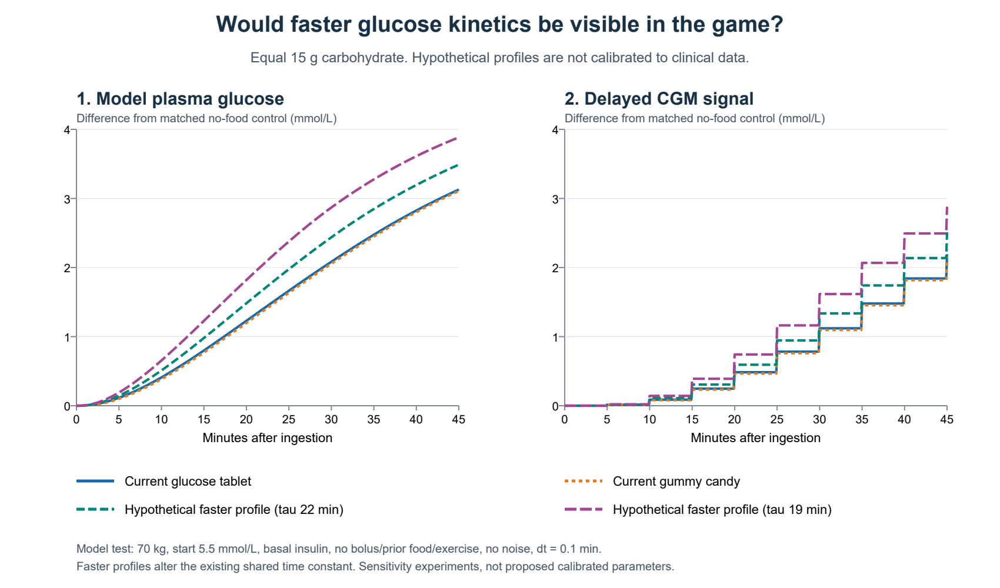

# Glucose-specific kinetics: feasibility and visible learning value

Date: 2026-10-25. Model-design analysis for T1D Simulator; no implementation or publication.

Decision status: **Recommendation only.** The owner requested this analysis; no specific architecture or parameter set has been approved. See the [review index](INDEX.md) for related work and its separate implementation status.

## 1. Decision in brief

A glucose-specific extension is worthwhile if it represents a defined tablet and food preparation, rather than a rule that glucose always acts faster than every sweet. An earlier rise than some chewy sweets is plausible and supported by a product comparison, but its size for the simulator's gummy candy remains uncalibrated. Adding water as a universal accelerator is not supported by the reviewed evidence.

The recommended first prototype separates gastric transfer from downstream glucose appearance, gives the tablet an explicit glucose identity, and compares equal carbohydrate quantities. Defer a general water item and detailed fructose metabolism. Any visible speed difference must follow calibration; it must not be invented to make the lesson conspicuous.

## 2. Scope and evidence quality

The question concerns ==type 1 diabetes (T1D)==, ==blood glucose (BG)== and the delayed signal from ==continuous glucose monitoring (CGM)== in fixed fictional characters. This is a focused feasibility review, not a systematic literature review or treatment protocol.

Original abstracts were checked for the three direct clinical comparisons below. Their full papers were not available locally for complete appraisal. Original human intestinal-perfusion pages were inspected for the hydrolysis mechanism. Water evidence includes original scanned research pages, a conference abstract and an archived article with missing graphical material. These distinctions limit parameter estimation, but permit a useful architectural decision.

## 3. What the research supports

### 3.1 Glucose versus sweets is product-dependent

In children with T1D, McTavish and Wiltshire compared glucose tablets, jellybeans, orange juice and Mentos using weight-based carbohydrate quantities. Jellybeans produced the lowest and slowest response; tablets did not differ significantly from juice or Mentos. This supports investigating a chewy-product difference, not assigning all sucrose a common delay ([McTavish and Wiltshire, 2011](https://www.ebi.ac.uk/europepmc/webservices/rest/search?query=EXT_ID:21443586%20AND%20SRC:MED&format=json&resultType=core), original abstract).

Husband and colleagues found no significant difference between glucose tablets and sucrose-labelled Skittles at their hypoglycaemia-resolution endpoint. The fructose-labelled fruit product was less effective. The product comparison does not isolate chemistry from its food matrix ([Husband et al., 2010](https://www.ebi.ac.uk/europepmc/webservices/rest/search?query=EXT_ID:19663922%20AND%20SRC:MED&format=json&resultType=core), original abstract). Neither study's non-significant comparison proves identical kinetics.

Slama and colleagues compared tablet, solution and gel preparations under insulin-induced hypoglycaemia. Their abstract reports comparable early responses for glucose and sucrose tablets/solutions, without establishing superiority of a glucose solution over tablets. It was not a same-tablet comparison with versus without extra water ([Slama et al., 1990](https://www.ebi.ac.uk/europepmc/webservices/rest/search?query=EXT_ID:2310277%20AND%20SRC:MED&format=json&resultType=core), original abstract).

The simulator's candy is specifically a gummy reference based on HARIBO Goldbears, not pure sucrose. The manufacturer's ingredients include glucose syrup, sugar, gelatine and dextrose. The published carbohydrate and sugar quantities are also distinct. Neither the ingredient order nor the nutrition panel gives exact glucose, sucrose and glucose-polymer fractions. The existing simple-sugar fraction of 1 should therefore not be treated as measured composition ([HARIBO, accessed 2026-10-25](https://www.haribo.com/da-dk/produkter/haribo/goldbears); project catalog: `docs/reviews/2026-09-06_food-catalog.md`).

### 3.2 Hydrolysis is real, but need not be the bottleneck

Sucrose must be split into glucose and fructose before their absorption; free glucose does not need that split. However, human intestinal-perfusion experiments found sucrose hydrolysis faster than absorption of its products and similar product absorption from sucrose and a matched free glucose/fructose mixture. The authors did not identify hydrolysis as the rate-limiting step under those conditions ([Gray and Ingelfinger, 1966](https://www.jci.org/articles/view/105354/files/pdf), original pp. 388 and 396 inspected).

This is evidence against inventing a long compulsory sucrose-digestion delay. It does not establish an oral tablet's response during T1D hypoglycaemia: stomach processing, the insulin background and subsequent metabolism were not the clinical comparison studied.

### 3.3 Water can matter without producing a universal maximum

With the same glucose amount in different drink volumes, a small scintigraphy experiment found faster emptying in millilitres per minute without a detectable difference in the emptied fraction; calculated energy delivery was broadly similar. More liquid leaving the stomach did not mean a proportionate increase in glucose delivery ([Leiper et al., 1996](https://www.cambridge.org/core/services/aop-cambridge-core/content/view/4A84183B980F2FB1DE805B562117C46F/S0029665196000213a.pdf/abstracts_of_communications.pdf), original conference abstract, printed p. 235A).

Other experiments show why this should not become a claim that water never matters. Vist and Maughan found effects of carbohydrate content and osmolality on gastric emptying; solutions were delivered directly into the stomach, so chewing and tablet dissolution were not tested ([Vist and Maughan, 1995](https://pmc.ncbi.nlm.nih.gov/articles/PMC1156540/), original scans). Sievenpiper and colleagues found higher intermediate glycaemia with their most diluted glucose drink. They measured BG, not gastric emptying, and studied people without previously diagnosed dysglycaemia rather than T1D hypoglycaemia. The available archive lacks the article's tables and figures; no effect size is used for calibration ([Sievenpiper et al., 2000](https://epe.bac-lac.gc.ca/100/201/300/cdn_medical_association/cmaj/vol-162/issue-7/0993.htm?nodisclaimer=1)).

The relevant quantities are separate: tablet dissolution, liquid volume emptied, glucose mass delivered to the intestine, systemic glucose appearance and net BG change. The search did not identify a directly appraised same-tablet, same-chewing T1D trial with versus without a defined water volume. This is a search limitation, not proof that no such experiment exists. No reviewed study identifies a universal fastest formulation or optimal water amount.

## 4. What the current model does

### Finding 1 - Shared chemistry and unequal pieces

Status: ⚠️ BY DESIGN, but insufficient for the requested distinction.

`js/foods.js:89` and `:238` assign tablets and candy the same carbohydrate type: simple fraction 1, no fibre and retention factor 1. A click delivers 3 g carbohydrate from a tablet but 4.6 g from candy; their eating times are 0.3 and 1 minute. Comparing clicks confounds speed with amount. Equal-carbohydrate tests are necessary.

### Finding 2 - One parameter changes two different processes

Status: ❌ ÅBEN for a future model revision.

Update 2026-10-25: **✅ FIKSET locally** by the approved profile-pool implementation.
See the [decision and verification record](2026-10-25_gastric-intestinal-fix.md).
Clinical glucose/gummy kinetic differentiation remains open; this status fixes
parameter coupling, not the missing calibration.

`js/physiology-engine.js:2133` computes one time constant from the whole stomach mixture. `js/hovorka.js:499` and `:629` use it for both stomach-to-gut transfer and gut-to-blood appearance. Consequently, new low-retention material in the stomach changes the exit rate of carbohydrate already in the downstream gut compartment. That is not an isolated tablet-dissolution mechanism.

For an isolated, fat-free sugar input at rest and BG below the hyperglycaemic modifier, the implemented relationship is: time constant = 25 minutes multiplied by (0.4 + 0.6 multiplied by retention factor). Retention 1 gives 25 minutes; 0.4 gives 16, not 10. The food-file comment claiming a 2.5-fold speed change is incorrect. The implementation document also incorrectly groups sucrose with glucose as needing no enzymatic digestion (`docs/MODEL-IMPLEMENTATION.md:775`). These documentation findings remain open; this analysis has not edited the app or its implementation description.

### Finding 3 - Water would expose an unintended shortcut

Status: ❌ ÅBEN; do not ship the tested shortcut.

Adding a hypothetical zero-carbohydrate water item to the existing weight mixture shifts the shared time constant. A deliberately invalid demonstration with 250 g water shifted it from 25 to about 16.51 minutes. It accelerated both gastric transfer and downstream appearance without modelling dissolution, fluid separation or concentration. This is a diagnosis of the shortcut, not a prediction of water's physiological effect.

## 5. Would users notice?

Fifty-four food scenarios and six matched no-food controls were run through the unchanged engine at integration steps of 1, 0.5 and 0.1 minute. Each food arm supplied exactly 15 g carbohydrate. The synthetic profile was 70 kg with steady basal insulin, no bolus, previous food or exercise, and sensor noise disabled. Starting BG was 5.5 or 3.5 mmol/L with identical insulin states. The low-BG case was artificially initialized, not induced by excess insulin, so it cannot validate clinical hypoglycaemia recovery.

At the 0.1-minute reference step and start BG 5.5, the following values are *food minus matched no-food control*, in mmol/L:

1. Current tablet after 15 minutes: plasma +0.80; CGM +0.25. Current gummy candy: plasma +0.77; CGM +0.23. The distinction is practically negligible on the graph and arises mainly from the brief eating-time difference.
2. Hypothetical time constant 22 minutes: plasma +0.98; CGM +0.31. Relative to the current tablet this is only about +0.06 on CGM at 15 minutes, growing to about +0.22 at 30 minutes.
3. Hypothetical time constant 19 minutes: plasma +1.23; CGM +0.39. Relative to the current tablet, the CGM difference is about +0.14 at 15 minutes and +0.50 at 30 minutes. This is more visible in a matched comparison.

These two hypothetical constants test perceptibility; neither is a proposed physiological calibration. Both alter the old coupled mechanism. Greater separation can be manufactured, but its size is not evidence of truth.

The existing interstitial filter has a time constant of about 13.7 minutes, with CGM samples every 5 minutes (`js/hovorka.js:160,688`; `js/physiology-engine.js:2892`). These are code settings, not newly estimated physiological constants. Sampling can hide a small early advantage or move a threshold crossing by an entire sample. Changing the integration step from 0.5 to 0.1 minute altered some endpoints by up to 0.050 plasma/0.038 CGM across the scenarios; threshold times should therefore not be overinterpreted. Noise and different sampling phases were not tested for perceptibility here.

A modest, evidence-supported difference could be educational in What If with matched quantities and overlaid curves. It may be difficult to recognize reliably from a single noisy CGM trace. That is a reason to improve comparison and explanation, not exaggerate absorption.

## 6. Recommended implementation scope

1. Define the tablet as free glucose and retain explicit physical form. Specify the gummy reference's composition only as far as product data permit. Do not label all candy pure sucrose or assign unmeasured chemical fractions.
2. Separate gastric transfer from intestinal/systemic appearance. Preserve the identity or effective profile of carbohydrate already beyond the stomach. Shared meal effects must enter through explicitly justified pathways, rather than changing every downstream pool through the stomach's current weighted average.
3. Start with a small number of product/form profiles. A product-level model can represent uncertain kinetics honestly without pretending to estimate each transporter or hepatic pathway. Retain gastric interactions with other food; fully independent meals would be another oversimplification. A detailed hydrolysis state is optional, not automatically necessary or identifiable.
4. Defer a general water button. If a later experiment needs a liquid comparator, use a defined glucose drink with a declared formulation, while keeping its kinetic uncertainty visible. Do not name it the fastest option without matching evidence.
5. Keep total absorbed carbohydrate, glucose-equivalent accounting and systemic glucose appearance distinct. A later chemical model must not discard sucrose's fructose component or turn it instantaneously into plasma glucose. The current complete-appearance assumption also deserves separate appraisal; changing it silently would affect the whole simulator.

This is a moderate model revision, not just an extra food-menu row. It reaches food metadata, engine intake states, the core gut equations, snapshots/What If, model documentation and targeted validation. A full glucose/fructose/liver/fluid model would be substantially larger and is not justified by the current evidence or learning goal.

## 7. Prototype acceptance and unresolved work

1. Freeze protocol-matched calibration targets after full-text appraisal. Reserve independent observations for validation. Net BG curves alone do not separately identify gastric emptying, intestinal absorption, hepatic production and insulin-mediated disposal.
2. Check mass accounting, ingestion boundaries, mixed meals, delayed tablet intake, snapshot continuation and What If replay. Repeat at multiple integration steps; document numerical error separately from physiological uncertainty.
3. Test a lower starting BG under a realistic insulin trajectory, not only the artificial state used here. Compare equal grams and ordinary player-selected pieces as distinct questions.
4. Quantify visibility with CGM noise and sampling-phase variation. Preserve any justified small physiological effect even when it is not reliably visible. Explain the difference through a controlled comparison rather than forcing an earlier sensor jump.

The current sensitivity runs passed delivery/mass checks, unchanged insulin initialization, no immediate state jump and deterministic repetition. Root read the script and independently reran it. They establish model behavior, not clinical accuracy. Overall review status: no critical numerical failure found in these bounded experiments; one shared-parameter warning, two documentation/composition cautions and an unresolved clinical calibration task.

## 8. Delegation, sources and reproducibility

Two Codex agents handled the engine experiments and water evidence. Gemini 4 Argon reviewed only a bounded packet and explicitly listed the original papers and code as unread. Its useful points were equal-dose comparisons, parameter separation and keeping general water out of the first prototype. Its unsupported fixed filtering-order explanation, universal water-plateau claim and arbitrary visibility decision threshold were not adopted. Model agreement is not scientific evidence.

Reproducible script, input/source hashes, full curves, source checks and private external review are in `.local-artifacts/2026-10-25-glucose-analysis/`. No app code, physiological parameter, commit, push or deployment changed in this analysis. The earlier release preparation remains on hold during model decision-making.

## References

1. Gray, G.M. and Ingelfinger, F.J. (1966). Intestinal absorption of sucrose in man: interrelation of hydrolysis and monosaccharide product absorption. Journal of Clinical Investigation, 45, 388-398. [Original PDF](https://www.jci.org/articles/view/105354/files/pdf). DOI 10.1172/JCI105354. Mechanistic passages visually inspected; not a complete appraisal of every experiment.
2. HARIBO (accessed 2026-10-25). Goldbears: ingredients and nutrition. [Manufacturer page](https://www.haribo.com/da-dk/produkter/haribo/goldbears). Local HTTP 200 and product/ingredient identity checked.
3. Husband, A.C., Crawford, S., McCoy, L.A. and Pacaud, D. (2010; online 2009). The effectiveness of glucose, sucrose, and fructose in treating hypoglycemia in children with type 1 diabetes. Pediatric Diabetes, 11, 154-158. [Original indexed abstract](https://www.ebi.ac.uk/europepmc/webservices/rest/search?query=EXT_ID:19663922%20AND%20SRC:MED&format=json&resultType=core). DOI 10.1111/j.1399-5448.2009.00558.x. Full text pending.
4. Leiper, J.B., Davidson, J. and Maughan, R.J. (1996). The effect of volume and glucose concentration on the gastric emptying rate of glucose solutions in man. Proceedings of the Nutrition Society, 55, 235A. [Original proceedings PDF, page 3](https://www.cambridge.org/core/services/aop-cambridge-core/content/view/4A84183B980F2FB1DE805B562117C46F/S0029665196000213a.pdf/abstracts_of_communications.pdf). Conference abstract; the PDF contains other abstracts not appraised here.
5. McTavish, L. and Wiltshire, E. (2011). Effective treatment of hypoglycemia in children with type 1 diabetes: a randomized controlled clinical trial. Pediatric Diabetes, 12, 381-387. [Original indexed abstract](https://www.ebi.ac.uk/europepmc/webservices/rest/search?query=EXT_ID:21443586%20AND%20SRC:MED&format=json&resultType=core). DOI 10.1111/j.1399-5448.2010.00725.x. Full text pending.
6. Sievenpiper, J.L., Jenkins, D.J.A., Josse, R.G. and Vuksan, V. (2000). Dilution of the 75-g oral glucose tolerance test increases postprandial glycemia: implications for diagnostic criteria. CMAJ, 162, 993-996. [Archived original prose](https://epe.bac-lac.gc.ca/100/201/300/cdn_medical_association/cmaj/vol-162/issue-7/0993.htm?nodisclaimer=1). Tables and figures unavailable in this copy.
7. Slama, G., Traynard, P.Y., Desplanque, N., et al. (1990). The search for an optimized treatment of hypoglycemia. Carbohydrates in tablets, solution, or gel for the correction of insulin reactions. Archives of Internal Medicine, 150, 589-593. [Original indexed abstract](https://www.ebi.ac.uk/europepmc/webservices/rest/search?query=EXT_ID:2310277%20AND%20SRC:MED&format=json&resultType=core). DOI 10.1001/archinte.1990.00390150083016. Full text pending.
8. Vist, G.E. and Maughan, R.J. (1995). The effect of osmolality and carbohydrate content on the rate of gastric emptying of liquids in man. Journal of Physiology, 486, 523-531. [Original scanned pages](https://pmc.ncbi.nlm.nih.gov/articles/PMC1156540/). DOI 10.1113/jphysiol.1995.sp020831.

All linked resources were checked from the local PC for status and identity. The indexed abstracts are labelled as such. Publisher/PubMed routes that returned access challenges were not presented as successfully accessed full texts. Raw research copies and derived material remain private.

## Abbreviation glossary

1. T1D - type 1 diabetes. The condition represented by the simulator's fictional characters.
2. BG - blood glucose. Here, the model's plasma glucose concentration unless otherwise specified.
3. CGM - continuous glucose monitoring. The sensor display follows a delayed interstitial signal and periodic sampling.
4. dt - integration time step. The simulated time advanced per numerical step; reducing it tests numerical sensitivity.

Overall status: analysis complete; model implementation and clinical calibration remain open.

## Follow-up, 2026-10-25: sucrose confectionery and custom food

Status: **Recommendation only; no catalog, UI or physiology changes approved or implemented.** This addendum is newer than the existing PDF export.

The owner asked whether replacing gummy candy with a sucrose-only confection could make the difference from glucose larger. A candidate is candyfloss prepared from a defined sucrose-based sugar. The [Pantom green candyfloss sugar specification](https://pantom.dk/wp-content/uploads/candyfloss_sugar_green.pdf) lists sugar, lime and lemon flavourings and colours, with no separately listed glucose syrup or dextrose. The manufacturer's PDF was retrieved from the local PC on 2026-10-25 (HTTP 200; product title and ingredient text checked). This establishes a candidate recipe, not a chemical assay of the finished confection or evidence of its glucose-response kinetics.

Replacing a mixed-sugar sweet with this candidate would make the ingredient comparison easier to define, but does not establish a larger physiological contrast. Slama et al. (1990), already reviewed above, reported similar early responses to glucose and sucrose tablets/solutions under their protocol. Its original indexed abstract was checked again; full-text appraisal remains pending. A sucrose-specific delay must not be chosen merely to amplify the game difference. Equal carbohydrate amounts and specified preparation/eating behaviour remain necessary for a meaningful comparison.

The custom-food UI currently exposes `sukker_fast` as one category for both glucose and ordinary sugar (`index.html`, custom-food carbohydrate chips; `js/i18n.js`, `food.custom.carbType.sugarSolidTitle`; `js/foods.js`, `CARB_TYPES`). If distinct glucose and sucrose behaviour is implemented, custom food should expose both **Glucose / dextrose** and **Table sugar / sucrose**, backed by the same physiology as catalog foods. Chemical identity and solid/liquid preparation are separate properties; adding a glucose choice must not imply that all drinks share one sugar composition. Do not add a cosmetic distinction while the underlying model still treats the choices identically.

Reusable conclusion: sucrose-based candyfloss is a catalog candidate, not a demonstrated slower comparator. Custom-food consistency belongs in the scope of any approved glucose extension. Reopen the product choice when a defined preparation and suitable response data are available. No replacement decision has been made.

Subsequent owner decision, 2026-10-25: retain gummy candy for now. The candyfloss replacement is not pursued. The requested concrete architecture and custom-food proposal is saved in [Separate gastric delivery and intestinal appearance](2026-10-25_codex_gastric-intestinal-proposal.md). Model implementation and kinetic parameters are still unapproved; the earlier PDF does not contain these follow-ups.

Implementation update, 2026-10-25: the owner subsequently approved the proposal.
The [local implementation record](2026-10-25_gastric-intestinal-fix.md) now
supersedes the earlier unapproved/unimplemented status. Glucose, sucrose and
gummy profiles have separate identities but the same provisional downstream
time; no clinical speed advantage has been established. The PDF remains the
earlier feasibility snapshot and does not include these later changes.
